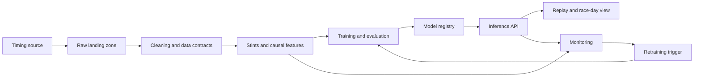

# Pitwall

**Tyre-life prediction for Formula 1, shipped as a reproducible MLOps platform.**

---

## The problem

Every Formula 1 stint is governed by a quantity nobody can measure directly: how much life is left in the tyre. Teams infer it from lap-time degradation, track evolution, fuel load, traffic and driver feedback. Public timing data contains no tyre sensor at all — no temperature, no wear, no pressure.

So the target has to be *derived*, the confounders have to be *removed*, and the uncertainty has to be *explicit*.

Pitwall estimates the remaining useful life of a stint as a probability distribution, exposes it through an API, and ships the whole path from raw timing data to a monitored, retrainable deployment.

## What it does

Given the state of a stint — circuit, driver, compound, and the laps completed so far — the API returns:

- a survival curve for the stint,
- a median remaining life with a credible interval,
- the exact model version, data version and source commit used for the prediction.

Predictions are computed from **causal features only**: nothing derived from laps that have not happened yet. This constraint is what makes the same contract usable for both historical replay and, later, race-day assistance.

## Architecture

Logical view. Physical infrastructure details are intentionally not published.



| Layer | Choice |
|---|---|
| Storage and query | Parquet + DuckDB |
| Data versioning | DVC, S3-compatible remote |
| Orchestration | Dagster, assets partitioned per event |
| Experiment tracking and registry | MLflow |
| Serving | FastAPI |
| Monitoring | Evidently, Prometheus, Grafana |
| Infrastructure | Terraform + k3s, GitOps with ArgoCD |

Every non-trivial choice is recorded as an Architecture Decision Record in [`docs/adr/`](docs/adr/).

## Design decisions

| ADR | Decision |
|---|---|
| [0001](docs/adr/0001-data-and-orchestration-stack.md) | Parquet + DuckDB, Dagster, DVC, MLflow |
| [0002](docs/adr/0002-prediction-target.md) | Remaining useful life as a right-censored survival problem |
| [0003](docs/adr/0003-inference-contract.md) | Stint-state inference contract, causal features, adapter-based ingestion |

## Roadmap

| Milestone | Deliverable | Status |
|---|---|---|
| Data foundation | Ingestion, data contracts, versioned raw snapshots | Planned |
| Model | Survival baseline, group cross-validation, evaluation report | Planned |
| Serving | Prediction API and race replay demo | Planned |
| Platform | Terraform-provisioned k3s cluster, GitOps deployment | Planned |
| Operations | Drift detection, delayed-label evaluation, scheduled retraining | Planned |

## Reproducing

The pipeline is meant to be reproducible end to end from a clean checkout:

```bash
make bootstrap
make reproduce
```

This is the target interface; it is not implemented yet.

## Development workflow

GitFlow. Work happens on `feature/*` branches cut from `develop`; releases are stabilised on `release/*` and merged into `main`, which is the only deployable branch. Releases are tagged with SemVer on `main`. Conventions are documented in [`AGENTS.md`](AGENTS.md).

Code, data and model versions move independently: a SemVer tag identifies the code, a DVC revision identifies the data, and an MLflow registry entry identifies the model. Every prediction records all three.

## Data, attribution and legal notice

Pitwall is an independent project. It is not affiliated with Formula 1, the FIA, Formula One Management, or any team.

Timing data is retrieved with [FastF1](https://github.com/theOehrly/Fast-F1), an unofficial client for publicly available timing feeds. Raw timing data is **not** redistributed in this repository; only derived aggregates and model artifacts are published.

"Formula 1", "F1", "FIA" and related marks are trademarks of their respective owners.

## License

Apache-2.0. See [LICENSE](LICENSE) and [NOTICE](NOTICE).
